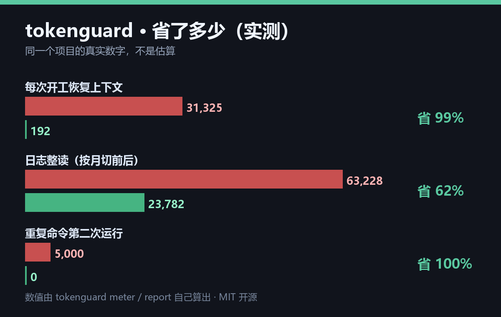

# tokenguard · 给 Agent 省 token

> **一个命令，五件事：量 · 控 · 省 · 算账 · 守门。**
> 免费、MIT、零依赖；装了 tokenizer 就是**精确值**，没装就明确标「估算」。



---

## 为什么做它

用 AI Agent 的人几乎都碰同一件事：**账单在涨，但不知道涨在哪。**

是读了一个 3 万 token 的日志？是同一条命令跑了几十遍？还是每轮把历史重新塞一遍？

**大多数「省 token 指南」告诉你要少读——问题是你不知道哪个文件该少读。**
tokenguard 干的就是这个：**先让浪费可见，再谈省。**

---

## 五个子命令

### 🚪 `read` —— 读前守门（最有用的一条）

```bash
tokenguard read 大文件.md                 # 超预算 → 只给前 25 行 + 指路
tokenguard read 大文件.md --grep "关键词"   # 只给命中行
tokenguard read 大文件.md --range 120-180  # 只给这段
tokenguard read 小文件.md                  # 小的直接给
tokenguard read 大文件.md --full           # 强制整读（会警告）
```

**实测（我们 31,453 token 的日志）**：

| 用法 | 放进上下文 | 省 |
|---|---|---|
| 整读 | 31,453 | 0 |
| **`read` 守门** | **329** | **31,124，省 99%** |
| `read --grep x` | 388 | 31,065 |
| `read --range 1-6` | 66 | 5,679 |

> **它不聪明，但它不让你犯错。** 把「要不要整读」从人的自觉，变成命令的默认行为。

### 📏 `meter` —— 读之前先量

```bash
tokenguard --model deepseek meter AGENTS.md 项目/日志.md
```

```
文件                          字   ≈token  建议
12-四小时日志.md            51925    31091  禁止整读：让脚本算结论
AGENTS.md                   9663     5469  别整读：grep + 局部
合计 36560 token（精确·deepseek-v3）
```

阈值：<800 可整读 / 3000 以下想清楚 / 8000 以下 grep+局部 / 超过 8000 别整读。

### 📝 `brief` —— 预览式简报替代整读

```bash
tokenguard brief AGENTS.md 计划.md
```

结构恒定（前缀稳定利于缓存），去重 + 限行，把「整读」换成「看骨架」。
实测：5,509 → **192 token**。

### 💾 `cache` —— 命令结果缓存（只缓存读类）

```bash
tokenguard cache --ttl 24h -- python tools/selfcheck.py
```

- **默认只缓存确定性读类命令**（读文件/grep/list/GET）
- 写操作要显式 `--allow-write`——**因为缓存写操作 = 假装成功**
- key 里带 cwd，换目录不会命中错缓存
- 单条上限 2MB，支持 `--force`

### 📊 `report` —— 看省了多少

```bash
tokenguard report          # 人看
tokenguard report --json   # 机器读
```

```
📊 tokenguard 账本（近 30 天 · 精确·deepseek-v3）
  read_guard ≈  31,124
  read_grep  ≈  31,065
  外包重活    ≈  30,000
  简报        ≈   6,519
  ──────────────────
  合计省下    ≈ 104,703 token
  粗估金额（2 元/百万 token）：≈ ¥0.21
```

账本在 `~/.tokenguard/ledger.jsonl`，一行一条，可删改。

### 🤝 `settle` —— 外包结账

```bash
tokenguard settle --tool workbuddy --pages 20 --note "某次调研"
```

把「交给免费工具做的重活」记成「省下的 token」——**外包要记账，不然不知道省没省。**

---

## 精确 vs 估算（不装精确，只装诚实）

```bash
pip install offline-token-counter   # 离线，429 个 tokenizer，含 DeepSeek / Qwen
```

| 方式 | AGENTS.md（9,663 字）| 误差 |
|---|---|---|
| 普通估算（1.2 字/token）| 4,443 | **低估 23%** |
| 标定估算（兜底用）| 4,779 | 低估 13% |
| **真 tokenizer（deepseek-v3）** | **5,469** | 基准 |

**没装 tokenizer 会明确标「估算」，绝不假装精确。**

---

## 装法

零安装：把 `tokenguard.py` 复制走，`python tokenguard.py ...` 就能用。
依赖：Python 3.8+；可选 `offline-token-counter`（要精确才装）。

---

## 它不做什么（边界）

- **不改模型**：KV cache、投机解码、路由都在服务端，碰不到
- **不是摘要**：`brief` 是骨架预览，别指望它替代理解
- **不保证适合所有人**：单人小量用它省不了多少钱；省钱靠「别重复读、别重复跑」

---

## 版本记录

| 版本 | 内容 |
|---|---|
| v0.2 | meter / brief / cache / report 四件套 |
| v0.3 | 修 7 个真问题（cache key 加 cwd、存 stderr、**写操作默认不缓存**、人民币计价、brief 预览化、--model）|
| v0.4 | 接真 tokenizer（offline-token-counter），标「精确/估算」 |
| v0.5 | `read` 读前守门——最薄的 hook |

---

## 团队版会怎么做（还没做）

个人看 `report` 就够。**团队才需要「谁在烧钱」**：
跨成员预算告警 · 策略下发（强制走缓存/保留失败路径）· 审计导出。
要做团队版的话，欢迎开 issue 说你的场景。

---

## License

MIT。
